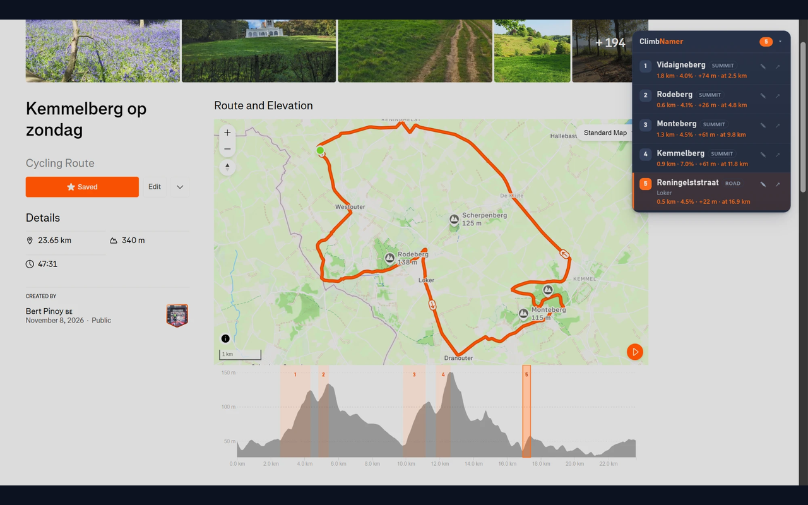

# ClimbNamer — for Strava

> **Install it as part of ClimbNamer for Garmin Connect and Strava.** The Chrome Web Store
> currently allows only two extensions on this publisher account, so the Strava version
> is published inside the Garmin Connect extension (since version 1.6.0):
> **[➜ ClimbNamer for Garmin Connect and Strava on the Chrome Web Store](https://chromewebstore.google.com/detail/climbnamer-for-garmin-con/ejokejjhepoeeebomjahihncemjbmfda)**
> · source: [ClimbNamer-Garmin](https://github.com/bertpinoy/ClimbNamer-Garmin).
> This repository holds the stand-alone Strava version it was built from.

A Chrome / Edge extension that **finds the climbs on your Strava routes and gives them
names**. Strava shows a route's elevation profile, but doesn't tell you where the climbs
are or what they're called. ClimbNamer does: *Kemmelberg*, *Rodeberg*,
*Col du Galibier*…

> **Not affiliated with Strava.** ClimbNamer is an independent project. It is not
> endorsed or sponsored by Strava. Strava is a trademark of Strava, Inc.

Sister projects: [ClimbNamer for Hammerhead Dashboard](https://github.com/bertpinoy/ClimbNamer) ·
[ClimbNamer for Garmin Connect](https://github.com/bertpinoy/ClimbNamer-Garmin).

## Features

- **Climbs detected automatically** on every route you open on strava.com, with criteria
  similar to Garmin's ClimbPro.
- **ClimbNamer panel** with every climb: name, length, average grade, elevation gain
  and where the climb starts.
- **Climbs on the elevation chart:** orange bands on Strava's own elevation profile,
  numbered like the panel. Hover a climb in the panel to highlight it on the chart.
- **Click a climb** in the panel to pick it out on the chart and point out its top on
  the map: Strava shows its own marker there, with distance and elevation.
- **Rename** a climb with ✎. Your name is used for that climb on every route.
- **Fast:** summit names are instant for Belgium, the Netherlands and Luxembourg, and
  for any area you looked at before; every climb is looked up only once.

Strava draws its map with its own engine, which extensions can't draw on; that's why
the climbs are shown on the elevation chart, and the map only shows the top of the
selected climb (with Strava's own marker).

## How climbs are detected

Strava doesn't list the climbs of a route, so ClimbNamer detects them from the route's
elevation profile, which Strava embeds in the route page itself (distance, elevation and
the route line):

- the profile is resampled every 20 m and smoothed over 100 m against elevation noise;
- a climb is a steady rise to a top: it starts where the slope (over 200 m) stays at
  least 2%, and ends at the top;
- a dip only ends a climb if it's at least 10 m and at least 25% of the height gained;
  climbing pieces less than 300 m apart without a real dip are one climb, as long as
  the combined climb is still steep enough;
- a climb counts if it's at least 300 m long, averages at least 3%, and
  length (m) × grade (%) ≥ 1,500 (for example 500 m at 3%).

The detection is the same as in ClimbNamer for Garmin Connect; the thresholds are at the
top of [`extension/climbs.js`](extension/climbs.js).

## How names are found

All names come from [OpenStreetMap](https://www.openstreetmap.org):

1. a named **summit or pass** (`natural=peak/hill/saddle`, `mountain_pass=yes`) within
   ~600 m of the highest point of the climb;
2. otherwise the **road** the climb mostly follows (in Flanders often the climb's name
   itself: *Koppenberg*, *Paterberg*, *Oude Kwaremont*);
3. otherwise *Climb near &lt;village&gt;*.

**Instant summit names.** Summits for **Belgium, the Netherlands and Luxembourg** are
included in the extension (about 1,150). **Elsewhere**, the first time you open a route
in an area, the named summits of that area (about 55 × 50 km) are downloaded once and
kept on your device. Names known locally are shown right away; climbs that need a
lookup follow.

If a name is wrong or missing, fix it in OpenStreetMap (everyone benefits) or rename the
climb with ✎.

## Fair use of OpenStreetMap services

ClimbNamer uses free public services run by volunteers and non-profits:

- **Each climb is looked up only once;** results are cached in your browser.
- **Summits per area, not per climb:** one request for a ~55 × 50 km area, one area at a
  time, refreshed after 180 days; Benelux needs none.
- **One request at a time:** Overpass mirrors are tried one after another, and Nominatim
  gets at most 1 request per second, as its
  [usage policy](https://operations.osmfoundation.org/policies/nominatim/) requires.
- Lookups only happen for the route you open; there are no background lookups.
- Requests identify the app as `ClimbNamer/<version> (+https://github.com/bertpinoy/Climbnamer-Strava)`.

## Privacy

No accounts, no analytics, no server of our own. ClimbNamer reads the route data the
Strava page already contains, inside your browser. Only climb coordinates (and the
outline of the area around them) are sent to the OpenStreetMap services to find names.
See the [privacy policy](PRIVACY.md).

## Install

**From the Chrome Web Store:** install [ClimbNamer for Garmin Connect and Strava](https://chromewebstore.google.com/detail/climbnamer-for-garmin-con/ejokejjhepoeeebomjahihncemjbmfda), which includes this Strava version.

**From source** (for development):

1. Download or clone this repository.
2. Open `chrome://extensions` (Chrome) or `edge://extensions` (Edge).
3. Turn on **Developer mode**.
4. Click **Load unpacked** and select the `extension` folder.
5. Open one of your routes on <https://www.strava.com> (Your routes → a route).

Click the ClimbNamer toolbar icon to open the settings: your custom names and the name
cache.

## Repository layout

| Path | Contents |
|---|---|
| `extension/` | The extension (Manifest V3). This folder is what gets packaged. |
| `extension/climbs.js` | Climb detection from a route's elevation profile |
| `extension/inject.js` | Runs in the page; reads the route data Strava embeds or loads (read-only) |
| `extension/content.js`, `content.css` | Panel, climb bands on the elevation chart, pointing out a climb on the map, rename |
| `extension/background.js`, `naming.js` | OpenStreetMap lookups, cache, fair-use limits |
| `extension/summits.js`, `extension/data/` | Instant summit names: bundled Benelux summits and downloaded areas |
| `extension/options.*` | Settings page |
| `store/` | Store listing texts and images |
| `tools/make-summits.py` | Rebuilds the bundled Benelux summit data from OpenStreetMap |
| `tools/make-graphics.py` | Draws the icons and store promo tiles (needs Pillow) |
| `tools/package.ps1` | Builds the upload zip in `dist/` |

The naming code (`naming.js`, `summits.js`, `background.js`) and the climb detection are
shared with [ClimbNamer for Hammerhead Dashboard](https://github.com/bertpinoy/ClimbNamer)
and [ClimbNamer for Garmin Connect](https://github.com/bertpinoy/ClimbNamer-Garmin); keep
fixes in sync and the version numbers equal.

## Releasing

1. Raise `version` in `extension/manifest.json`.
2. Run `powershell -File tools/package.ps1`. This creates `dist/ClimbNamer-Strava-<version>.zip`.
3. Upload the zip in the Chrome Web Store Developer Dashboard. The listing texts are in
   [`store/listing.md`](store/listing.md).

If Strava changes its route pages, the parts most likely to need an update are the
data sources in `extension/inject.js` (`__NEXT_DATA__`, `/_next/data/…/routes/<id>.json`)
and the chart selector in `extension/content.js` (`ElevationChart_hitbox`).

## License

Copyright 2026 bertpinoy. The code is licensed under the [Apache License 2.0](LICENSE).
Map data is not covered by this license; see below.

Map data © [OpenStreetMap contributors](https://www.openstreetmap.org/copyright), ODbL. See [DATA-LICENSE.md](DATA-LICENSE.md).
